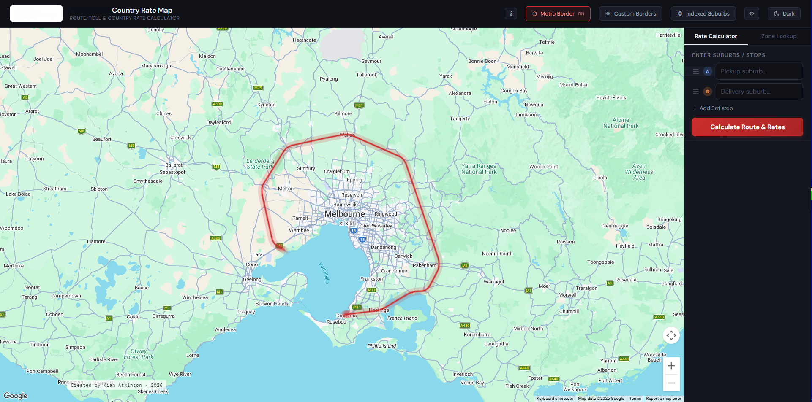
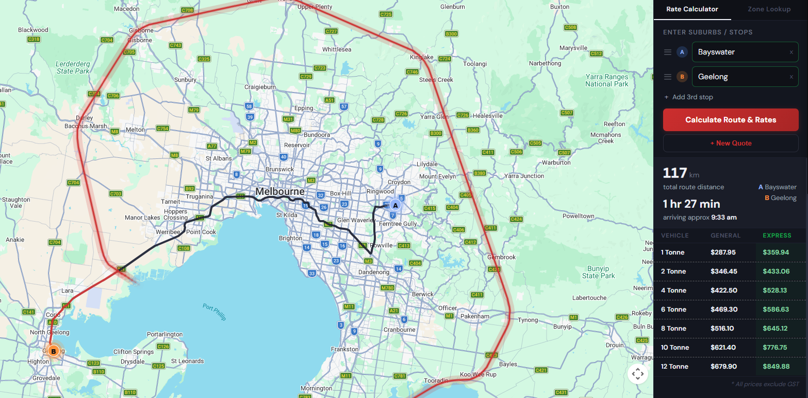
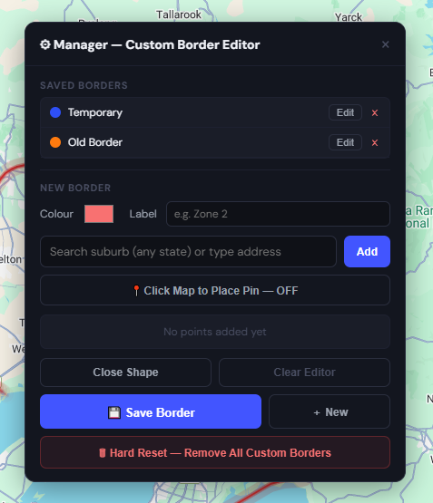
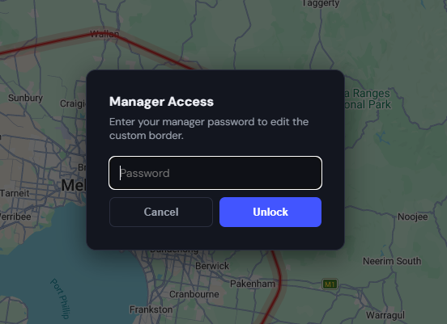
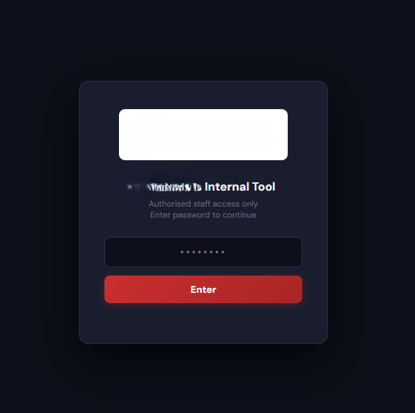
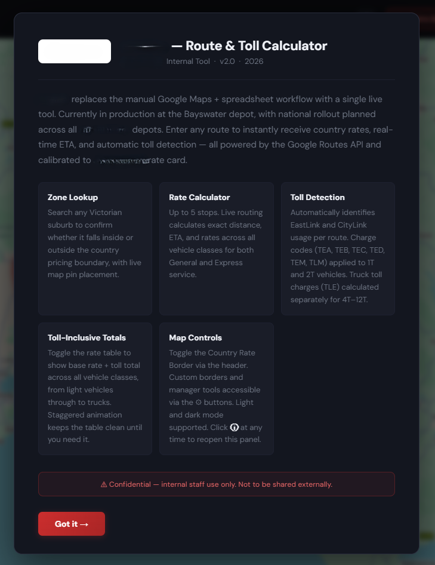

# Transport Company Map — Country Rate Calculator

A single-file route pricing and zone classification tool built for a Melbourne
courier company. Calculates multi-stop country freight rates across seven vehicle
classes, detects toll corridor usage per route, and classifies pickup and delivery
points against a management-defined metro boundary.

Built and maintained solo, in production use by dispatch staff.



*The metro boundary as staff see it. Pricing resolves against the underlying
polygon — the rounded, glowing line is presentation only.*

---

## About this repository

This is a **sanitised public build** of an internal tool. It is published as a
portfolio artefact with the deliberate omissions described below.

**What has been changed:**

| Removed | Replaced with |
|---|---|
| Google Maps API key | `YOUR_GOOGLE_MAPS_API_KEY` placeholder |
| JSONBin master key and bin ID | Placeholders |
| Site and manager passwords | `demo` / `demo-manager` |
| Commercial rate card | Synthetic per-km rates with identical structure |
| Toll pricing and truck toll caps | Synthetic values |
| Full indexed suburb list (144 entries) | Representative sample (30 entries) |
| Company branding, logo, depot and internal tool names | Generic mark and neutral wording |

**What is unchanged:** every line of application logic. The architecture, the
polygon classification, the toll combination rules, the routing integration, the
border geometry, and the interface are exactly as they run in production.

All employer-identifying content — company name, logo, depot location and internal
tool names — has been removed. The commercial values are the company's; the
engineering is mine.

### Why the history starts here

The production version of this tool runs inside a working dispatch operation. It
holds live API credentials, a commercial rate card, and the suburb classification
index that pricing depends on. None of that is publishable, and sanitising the
existing repository would not have made it so: a credential committed once stays
recoverable from orphaned commits, forks and cached views long after it is deleted
from the working tree. Scrubbing history is a control that fails silently — you
find out it was incomplete after publication.

So this repository was built clean rather than cleaned up. It was generated from
production by a scripted sanitisation pass, audited against every credential and
commercial value in the original, and committed from zero. The two repositories
share no history, and neither can be reconstructed from the other.

The absent history is the control, not a gap in one. Publishing an employer's
operational codebase — even a scrubbed one — offers a reader more than code: which
external services it authenticates against, where its data is stored, which
controls exist and which do not. That is reconnaissance material for a live
business system, and the fact that the tool is genuinely in production is exactly
why it should not be handed over. The engineering is mine to show. The operational
detail around it is not.

What is lost is a commit trail, which is the cheaper thing. What is protected is a
system real people use to quote real freight.

---

## Running it

No build step, no dependencies, no server.

1. Clone the repository
2. Open `index.html` and replace `YOUR_GOOGLE_MAPS_API_KEY` with a Google Maps
   JavaScript API key that has the Maps, Routes and Geocoding APIs enabled
3. Open `index.html` in a browser
4. Site password: `demo` — manager tools password: `demo-manager`

The JSONBin overlay is optional. Without credentials the app runs entirely on its
hardcoded data; the manager editor will load but cannot persist.

> If you are deploying this anywhere reachable, restrict the Maps key by HTTP
> referrer in Google Cloud Console. An unrestricted browser key is billable by
> anyone who reads your source.

---

## Architecture

One HTML file. Vanilla JavaScript, no framework, no build tooling.

```
index.html
├── Hardcoded base layer      metro border, suburb index, rate tables, toll rules
├── JSONBin overlay           runtime custom borders and suburb overrides
├── Google Maps JS API        rendering, geocoding
└── Google Routes API v2      live route legs, distance, duration
```

The single-file constraint was chosen deliberately: the tool is deployed by staff
without developer tooling, and needs to work from a shared link or a local copy
with no install step.

### Pricing is decided in exactly one place

Every pricing decision resolves through `pointInPolygon` against `inHullArr` — the
hardcoded 11-point metro boundary. The `isOutOfMetro` flag on indexed suburbs is
display metadata and never determines a rate.

This is the most important invariant in the codebase. An earlier iteration derived
the boundary from a convex hull of indexed suburbs, which meant two sources of
truth could disagree — and they did, silently, for towns near the edge. Collapsing
to one polygon check made the classification auditable and the bug class impossible.

---

## Features

### Country rate calculator
- Up to 5 stops with drag-and-drop reordering
- Live route calculation via Google Routes API v2
- Animated distance counter and ETA display
- Rates across all vehicle classes (1T, 2T, 4T–12T) for General and Express
- Automatic all-metro vs country detection; metro routes redirect to the internal
  metro pricing tool



*A country route with the border crossing split visible: charcoal for the metro
leg, red beyond the boundary. Rates shown are synthetic.*

### Toll detection and calculation
- Detects CityLink, EastLink and West Gate Tunnel usage per route via corridor
  bounding boxes and route geometry
- Six EastLink charge codes plus CityLink, applied to light vehicles
- Separate truck toll resolution for 4T–12T with a flat City & East cap
- Toll-inclusive totals row across all vehicle classes
- Combination logic: CityLink absorption rules, paired-code resolution, and a
  short-run discount zone

### Zone lookup
- Search any suburb or address
- Live map pin placement
- Border-based inside/outside classification

### Country rate border
- Hardcoded 11-point boundary, revised to bring two edge towns inside metro
- Single source of truth for all pricing decisions
- Displayed on load; toggleable via header
- Rendered as three layered polylines with rounded corners and fade-out tails
  across the bay — visual smoothing only, the pricing polygon stays angular

### Route visualisation
- Two-tone route line: metro leg in charcoal, country leg in red, split at the
  exact border crossing coordinate
- Animated ping fired at the crossing point as the route draws
- Pulse-beacon stop markers with per-stop colour
- Hover a marker to fade it and read the suburb beneath

### Keyboard navigation
- Arrow keys move the highlight through suggestions
- Enter selects highlighted, or top result if none
- Escape closes the dropdown
- Applies to dynamically added stops as well as initial inputs

### Manager tools (password-protected)
- **Custom border editor** — draw overlays via geocoded search or click-to-place
  pins, with colour and label customisation. Custom borders are **visual reference
  only** and deliberately not wired to pricing or classification
- **Suburb editor** — two-column drag-and-drop for adding, removing, repositioning
  and classifying indexed suburbs
- Hard reset to remove all custom borders
- Changes persist to JSONBin and propagate on next load



*Saved overlays are visual reference only and are deliberately not wired to
pricing or classification.*



### Interface
- Dark and light mode
- Branded logo entrance animation on the gate — jet flies in with contrail and
  ember flare, wordmark fades in behind. Plays once per browser session
- Out-of-metro pickup warning with hub suggestion
- Stale quote warning after 5 minutes
- First-visit modal, reopenable



*The gate carries a branded entrance animation — the mark flies in with its
contrail before the wordmark resolves. Plays once per browser session.*



---

## Security posture

The production deployment is a static single-file client-side application with no
backend and no server-side authentication. Everything shipped to the browser is
readable by anyone who opens developer tools. The following are known and accepted
rather than overlooked:

- **Client-side password gates are cosmetic.** Both gates are JavaScript string
  comparisons and can be bypassed by editing session storage or removing the gate
  element. They deter casual snooping only.
- **All application data reaches the client** before any gate is evaluated.
- **The Google Maps key is client-side by necessity** and must be constrained by
  HTTP referrer restrictions.

The tool is distributed by private link to internal staff, the sensitive data is
commercial rather than personal, and the realistic worst case is disclosure to
someone who already held the URL.

### Planned hardening

1. Retire the JSONBin dependency once the national border is locked. The overlay
   exists to allow live border edits; once fixed and hardcoded, the store, its
   credential and the manager gate are all deleted. This eliminates the secret
   rather than protecting it.
2. Move authentication off the client. A Netlify edge function intercepts requests
   before any file is served, returning a login form unless a valid session cookie
   is present, with the password held in an environment variable. This is the first
   control that actually prevents an unauthenticated party from reading the source.
3. On rollout beyond the originating depot, hand authentication to corporate SSO.
   Per-user identity, revocation tied to existing offboarding, an access audit
   trail, and no shared secret to leak.

Network-level restriction is a viable supplementary control but not a substitute
for identity — depots on separate networks and mobile access are common enough that
network scoping alone would obstruct legitimate use.

### Principle

Nothing delivered to a browser is secret. Obfuscating a client-side credential is
not a control and will not be implemented in place of one. The security boundary
belongs on infrastructure the client cannot reach.

---

## Known limitations

- One town north-east of the boundary currently falls outside the metro polygon and
  requires an additional border point to resolve
- One peninsula region is not yet fully suburb-indexed

---

## What I learned

- How to set up and manage Google Cloud APIs from scratch
- API key security — the difference between HTTP referrer and API-type
  restrictions, and why one can silently break functionality
- Where the security boundary actually sits in a client-side application: nothing
  delivered to a browser is secret, client-side gates are UX rather than access
  control, and obfuscating a credential is not a substitute for moving it
  server-side
- How to threat model honestly — distinguishing a credential that grants an
  attacker new capability from data they already hold, and prioritising by blast
  radius rather than by what feels alarming
- The difference between network-level and identity-level access control, and why
  SSO scales to a multi-site rollout where VPN scoping does not
- How to publish work safely — separating an employer's commercial data and live
  credentials from my own engineering, and recognising that a public repository
  leaking either would undermine the competence it was meant to demonstrate
- Why a system needs one source of truth — the costliest bug here came from a
  second, stale signal that looked authoritative
- How to debug coordinate errors by cross-referencing real geographic data
- That derived state isn't lost state — a boundary I thought I had overwritten was
  recoverable by re-running the original algorithm against an older committed
  version
- To validate an assumption against the person who knows the domain before building
  on it — a technically correct reconstruction was still the wrong boundary, and
  only local knowledge caught it
- The value of iterative, single-feature-at-a-time development, and of iterating
  locally when deployment is the scarce resource
- Knowing when not to build — hardening ahead of the rollout that justifies it
  would have cost more than it returned
- Why proper Git workflow with descriptive commit messages beats README diary
  entries — code history belongs in version control, not documentation
- How to navigate a workplace AI policy situation proactively and turn it into
  approval rather than a problem
- That a single well-structured HTML file can be a genuinely production-grade
  business tool

---

## Licence

Published for portfolio review. Not licensed for reuse or redistribution.
[README.md](https://github.com/user-attachments/files/31856572/README.md)
